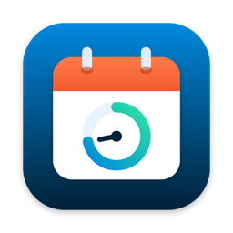

<p align="center">
  
</p>

<h1 align="center">Harri NextUp</h1>

<p align="center">
  A macOS menu bar app that counts down to your next meeting, so you're never caught off guard.
</p>

---

Harri NextUp sits in your menu bar and shows your next meeting and how long until it starts, like `Standup · 8m`. As the meeting gets closer, the label changes colour. During a meeting it shows how much time is left. Click it to see today's agenda, spot overlapping meetings and join calls in one click.

## Features

- **Live countdown in the menu bar.** Shows minutes until the next meeting, switching to `m:ss` in the last five minutes, and time left once it starts.
- **Colour that tells you when to move.** In Harri brand colours: the label turns blue, then orange as a meeting approaches, and green while it's running. Each colour has a deep shade for light menu bars and a bright one for dark menu bars, with at least 4.5:1 contrast on both.
- **One-click join.** Finds Google Meet, Zoom and Microsoft Teams links in the event's URL, location or notes.
- **Overlap handling.** Shows `+N` when meetings overlap and lists the conflict in the dropdown. If a meeting that overlaps the current one starts within 10 minutes, it takes over the countdown.
- **Today's agenda.** The dropdown lists today's remaining meetings, and when your day is clear, it shows tomorrow's first meeting.
- **"Starting soon" notifications.** Sent 1 to 10 minutes before a meeting.
- **Stays out of the way.** No Dock icon, launch at login, and it skips declined, cancelled and all-day events by default.

## Menu bar label

| State | Colour | Default trigger | Example |
|---|---|---|---|
| Plain | System text colour | More than 10 minutes away | `Design review · 42m` |
| Soon | Blue | 10 minutes or less to go | `Standup · 8m` |
| Urgent | Orange | 2 minutes or less to go, or the last 5 minutes of a running meeting | `1:1 · 1:42` |
| In progress | Green | Meeting is running | `AI/ML Team · 14m left` |

The blue and orange thresholds can be changed or turned off in Preferences. With no meetings left today the label is a calendar icon, and with calendar access off it's a calendar icon with a warning badge.

## Requirements

- macOS 14.6 or later
- Calendar access, which the app asks for on first launch

Harri NextUp reads the calendars that are already on your Mac through EventKit. To include Google or Microsoft 365 calendars, add the account in **System Settings › Internet Accounts** with **Calendars** turned on.

## Installation

There's no packaged release yet, so build it from source:

```bash
git clone https://github.com/anas-eid/MeetingCountdown.git
cd MeetingCountdown
xcodebuild -project MeetingCountdown.xcodeproj -scheme MeetingCountdown -configuration Release -derivedDataPath build build
```

Then copy the app to Applications and open it:

```bash
cp -R "build/Build/Products/Release/Harri NextUp.app" /Applications/
open "/Applications/Harri NextUp.app"
```

To start it automatically, open **Preferences** from the dropdown and turn on **Launch at login**.

> **Sharing a build:** a local build is signed to run on the Mac that built it. To share the app with other Macs, sign it with a Developer ID certificate and notarize it through Xcode's Organizer.

## Preferences

| Section | Setting | Default |
|---|---|---|
| Menu bar | Show meeting title | On |
| | Max title length | 18 characters |
| | Countdown format: adaptive, always minutes, or always `m:ss` | Adaptive |
| Alerts | Turn blue at: off, 5, 10 or 15 minutes | 10 minutes |
| | Turn orange at: off, 1, 2 or 5 minutes | 2 minutes |
| | Send a notification, 1, 2, 5 or 10 minutes before | On, 1 minute |
| Calendars and events | Which calendars to include | All except subscribed and birthday calendars |
| | Hide declined events | On |
| | Ignore all-day events | On |
| General | Launch at login | Off |

## Privacy

Harri NextUp runs entirely on your Mac. It reads your calendars through Apple's EventKit, makes no network requests, and stores only its preferences in `UserDefaults`. Join links open in your default browser or meeting app.

## Development

The project is plain Swift with SwiftUI, AppKit and EventKit, and has no third-party dependencies. Open `MeetingCountdown.xcodeproj` in Xcode, or build and test from the command line:

```bash
xcodebuild -project MeetingCountdown.xcodeproj -scheme MeetingCountdown -configuration Debug build
```

```bash
xcodebuild test -project MeetingCountdown.xcodeproj -scheme MeetingCountdown
```

The project, scheme and Swift module are still named `MeetingCountdown`; only the built app is called Harri NextUp.

How it's put together:

| File | Role |
|---|---|
| `AppSettings.swift` | Preferences, saved to `UserDefaults` |
| `CalendarService.swift` | Reads and filters events through EventKit |
| `MeetingEngine.swift` | Picks the meeting to show, runs the countdown and sends notifications |
| `StatusItemController.swift` | The menu bar item, its coloured label and the dropdown popover |
| `MenuView.swift`, `PreferencesView.swift` | The dropdown and the preferences window (SwiftUI) |
| `Brand.swift` | Harri brand palette and the readable text shades derived from it |
| `Models.swift` | Meeting model and join-link detection |
| `MeetingCountdownTests/` | Unit tests for choosing the meeting, tones and time formatting |
| `Tools/draw_icon.swift` | Draws the app icon; run with `swift Tools/draw_icon.swift out.png` |

[CLAUDE.md](CLAUDE.md) has more detail on the architecture.

### Branches

- `v1`: active development
- `dev`: integration; changes land here through pull requests from `v1`
- `main` and `master`: not pushed to directly

## Author

Developed by **AnAs** ([anas.eid@harri.com](mailto:anas.eid@harri.com)).
